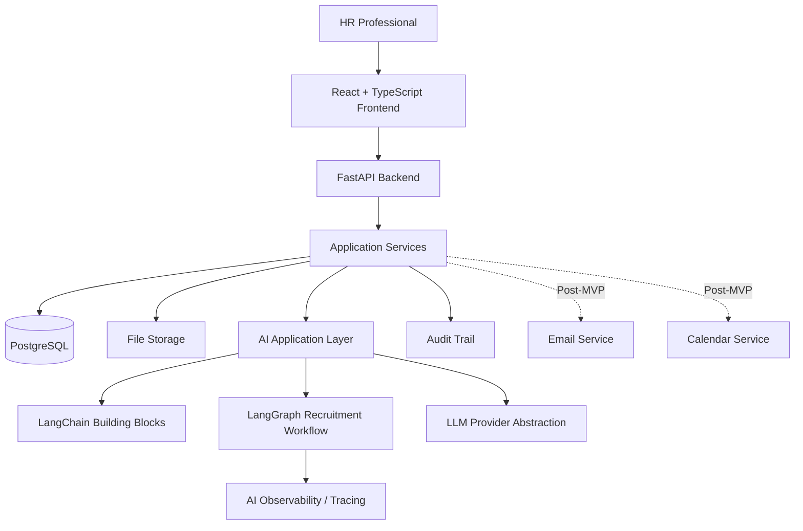
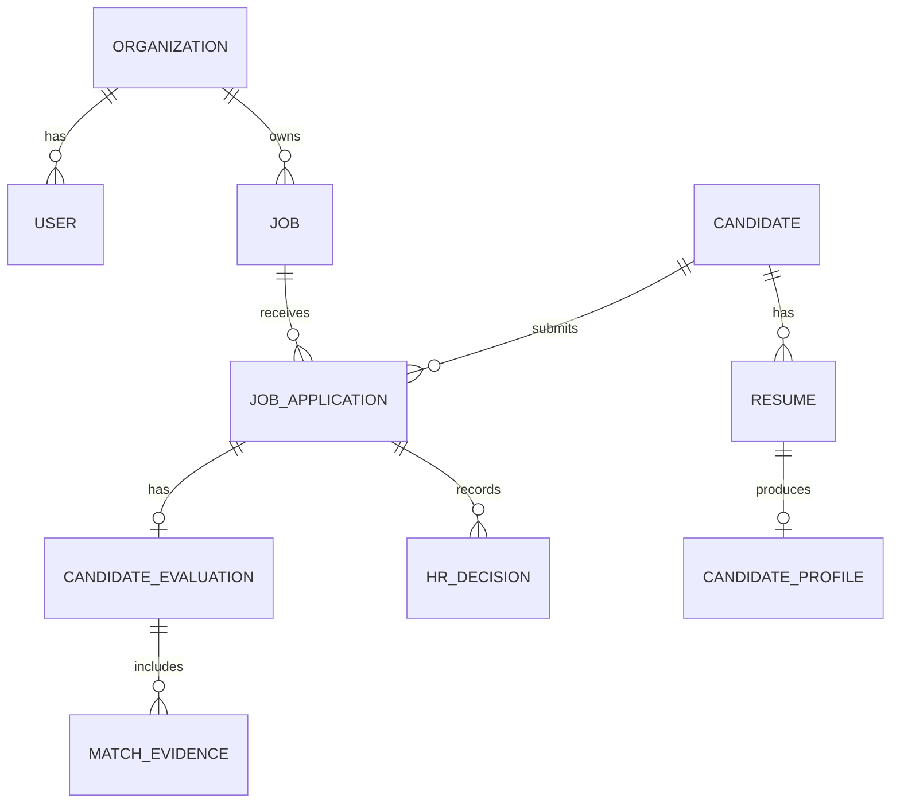
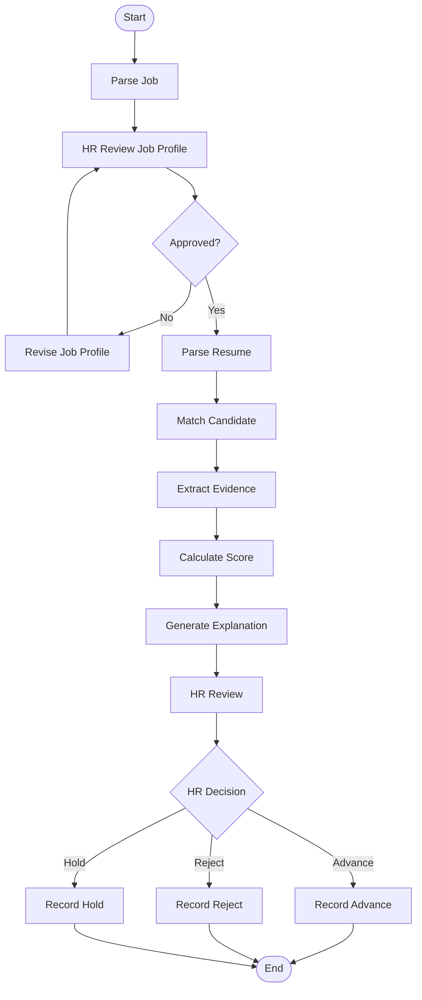
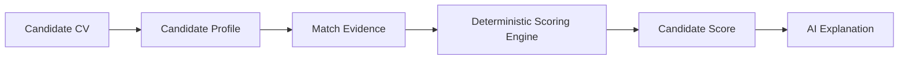

# Architecture

## Architecture Principles

The system should use this separation:

```text
Frontend
-> FastAPI
-> Application Services
-> Database / Storage
```

AI functionality should exist as a separate application layer.

LangGraph should orchestrate workflows where stateful orchestration, conditional routing, or human-in-the-loop behavior provides real value.

LangChain should provide AI building blocks where useful.

External integrations should be isolated behind service or tool interfaces.

Business logic should not depend directly on a specific LLM provider.

The system should allow changing the LLM provider without rewriting core business logic.

## High-Level Architecture



## Component Responsibilities

### Frontend

The frontend provides the HR interface for:

- Job Description intake.
- Job Profile review.
- Candidate CV upload.
- Candidate ranking and grouping.
- Candidate filtering and search.
- Candidate detail review.
- AI explanation inspection.
- HR decision capture.

### FastAPI Backend

The backend provides API boundaries and coordinates:

- Request validation.
- Application services.
- Persistence.
- File handling.
- Workflow execution.
- AI workflow entry points.
- Audit trail recording.
- Integration interfaces.

### Application Services

Application services contain business behavior that should remain independent of LLM provider details.

They should own:

- Candidate/job/application logic.
- Scoring.
- Ranking.
- Filtering.
- Permission checks.
- Audit trail events.
- Coordination with repositories and AI services.

### Database

PostgreSQL is the initial database choice.

The exact database fields are not finalized and should be defined before implementation.

### File Storage

File storage stores uploaded CVs and related extracted artifacts.

The specific production storage provider is a decision to be finalized.

## AI Layer

The AI layer is responsible for:

- Job Description understanding and extraction.
- Resume understanding and extraction.
- Matching evidence extraction.
- Candidate evaluation assistance.
- Explanation generation.
- Later interview assistance.
- Later HR preference analysis.

AI outputs should use explicit structured schemas and validation whenever possible.

AI must not independently make final hiring decisions.

## LangChain Role

LangChain may be used for:

- LLM integrations.
- Structured outputs.
- Prompt management.
- Tools.
- Retrieval.
- Model abstraction where appropriate.

LangChain should not be used simply because this is an AI project. Use the simplest appropriate abstraction.

## LangGraph Role

LangGraph should be used for stateful workflow orchestration where it provides real value.

It should not replace the normal backend architecture.

Conceptually:

```text
FastAPI
-> Recruitment Workflow
-> LangGraph
```

Use explicit typed state.

Do not duplicate business logic inside LangGraph nodes. Existing tested services should be reused by graph nodes.

## Multi-Agent Strategy

Do not assume every AI component is an agent.

Before introducing an agent, evaluate:

1. Does it require reasoning?
2. Does it make decisions?
3. Does it need tools?
4. Does it need state?
5. Does it benefit from autonomous task planning?
6. Could a normal LLM service or function solve the problem more simply?

If a normal service is sufficient, use the normal service.

Multi-agent architecture should be introduced only where it provides measurable value.

## Database Conceptual Model



This is a conceptual model only. Final database fields are a decision to be finalized before implementation.

## Recruitment Workflow



## Human Approval Points

Human approval is required at minimum for:

- Approved Job Profile:
  Raw Job Description -> AI extraction -> HR review -> Approved Job Profile.
- Final Candidate Decision:
  AI analysis -> Score + Evidence + Recommendation -> HR review -> Final HR Decision.

The AI recommendation must never automatically become the final HR decision.

## Matching And Scoring Architecture



The LLM should not invent the final score.

The scoring weights are locked for Phase 4.2 in `backend/app/services/scoring_service.py`:
category weights `must_have=3`, `important=2`, `nice_to_have=1`; evidence values
`matched=1.0`, `partial=0.5`, `missing=0.0`; and
`Score = [sum(weight x evidence_value)] / [sum(weights of ALL approved requirements)] x 100`,
normalized to 0-100 with `SCORING_VERSION = "1.0"`. A missing must-have is a
non-penalizing review signal only: no penalty and no auto-reject. `dimension` is
not weighted and `strength` is excluded. A per-requirement breakdown is stored
in `candidate_evaluations.score_breakdown`. These weights may be revisited in a
later phase with explicit approval.

## Observability

AI workflows must be observable.

The system should be able to identify:

- Workflow run.
- Graph node.
- AI component or agent.
- Model/provider.
- Prompt version.
- Input/output schema.
- Latency.
- Token usage when available.
- Validation errors.
- Retries.
- Final status.
- Failure location.

The purpose is to answer:

```text
What exactly happened when the AI produced this result or failed?
```

Do not create an Error Tracking Agent. Observability is infrastructure.

The exact observability technology is a decision to be finalized before implementation.

## Error Handling

Errors should be diagnosed before fixes are implemented.

For AI workflow failures, error information should identify:

- Workflow run.
- Node or component responsible.
- Tool or model call involved.
- Input and output schema.
- Validation error, timeout, provider error, or infrastructure issue.
- Retry attempts and final status.

Errors should not be hidden with broad exception handling.

## Security Considerations

Initial security considerations:

- Uploaded CVs contain personal data and must be protected.
- Access to jobs, candidates, applications, decisions, and traces must be permission-controlled.
- LLM prompts and traces may contain sensitive candidate data.
- External integrations must be isolated behind clear interfaces.
- Authentication provider is a decision to be finalized.
- Authorization model is a decision to be finalized.
- File storage provider and access policy are decisions to be finalized.

## Decisions To Be Finalized

The following are intentionally not finalized:

- Final scoring weights.
- Final database fields.
- Specific LLM provider.
- Specific observability provider.
- Specific queue/background worker.
- Authentication provider.
- Email provider.
- Calendar provider details.
- Production file storage provider.
